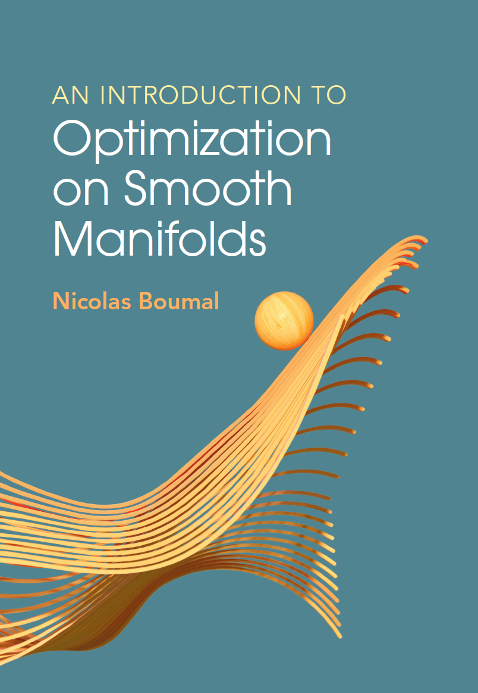

::::: {.container .tutorial-page}
:::: {.row}
::: {.col-sm-12 .col-lg-9}

::: {.page-header}
# 2023 SIAM Conference on Optimization Tutorial on Riemannian Optimization <a href="../index.html"><small class="tutorial-author">Nicolas Boumal</small></a>
:::

:::: {.media .row}
::: {.col-lg-3 .col-md-3 .col-sm-12}

[{.book-cover fig-alt="Cover of An introduction to optimization on smooth manifolds"}](https://www.nicolasboumal.net/book){target="_blank" rel="noopener"}

:::
::: {.col-lg-9 .col-md-9 .col-sm-12 .prose}

This is the web page for a [minitutorial at SIAM OP 2023](https://www.pathlms.com/siam/tracks/12324/courses/54629?){target="_blank" rel="noopener"} in Seattle, WA (June 3rd).

The two lectures of 90 minutes each were recorded: [video 1](https://www.pathlms.com/siam/courses/54629/sections/62408/video_presentations/262676){target="_blank" rel="noopener"}, and [video 2](https://www.pathlms.com/siam/courses/54629/sections/62410/video_presentations/262678){target="_blank" rel="noopener"}.

Here are [the slides used during the tutorial](Tutorial%20SIAM%20Optimization%202023.pdf){target="_blank" rel="noopener"}.

These are the [Manopt example codes for Max-Cut](manopt_maxcut_example.zip){target="_blank" rel="noopener"} in Matlab.

The tutorial builds on my book published by [Cambridge University Press](https://cambridge.org/9781009166157){target="_blank" rel="noopener"}, 2023.

Go to the [book webpage](https://www.nicolasboumal.net/book "Go to webpage of book An introduction to optimization on smooth manifolds"){target="_blank" rel="noopener"} for more info, the free pre-publication pdf, lecture material (videos and slides of a full semester course) and exercises with solutions.

For software, check out the Manopt toolboxes, in [Matlab](https://www.manopt.org){target="_blank" rel="noopener"}, [Python](https://www.pymanopt.org){target="_blank" rel="noopener"} and [Julia](https://www.manoptjl.org){target="_blank" rel="noopener"}. You can also find a list of much more Riemannian optimization software [here](https://www.manopt.org/about.html#related){target="_blank" rel="noopener"}.

:::
::::

::: {.page-footer}
Last update: Feb. 19, 2025.
:::

:::
::::
:::::
